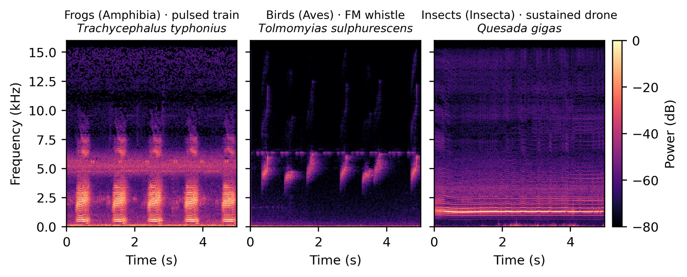
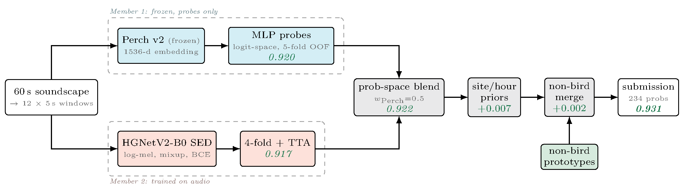
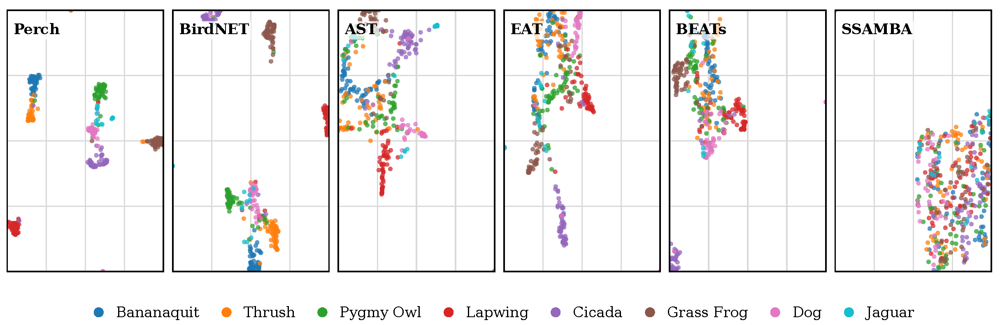

# DS@GT ARC at BirdCLEF+ 2026

**Can Tokens Compete? Token Representations against Supervised CNN Backbones for BirdCLEF+ 2026**

Anthony Miyaguchi, Murilo Gustineli, Adrian Cheung — Data Science at Georgia Tech, Applied Research Competitions (DS@GT ARC), Georgia Institute of Technology

[BirdCLEF+ 2026](https://www.imageclef.org/BirdCLEF2026) challenge (LifeCLEF lab, CLEF 2026, Jena, Germany)

[📄 Paper (CEUR-WS)](https://ceur-ws.org/Vol-4283/paper353.pdf) · [📑 arXiv:2607.14474](https://arxiv.org/abs/2607.14474) · [🎤 CLEF 2026 slides (PDF)](docs/slides/birdclef2026-clef-talk.pdf) · [📚 Citation](#citation)

## The task

Autonomous recorders in the field capture hours of "soundscape" audio, and ecologists want to know which animals are calling in it.
BirdCLEF+ 2026 asks for multi-label detection of 234 species (birds, frogs, insects, mammals and reptiles) in 60-second soundscapes from the Pantanal wetlands in Brazil, scored per 5-second window with macro ROC-AUC.

The data is large but sparsely labeled.
There are 522 hours of audio: 344.5 h of crowd-sourced focal recordings (mostly birds) and 177.6 h of soundscapes from 23 sites, of which only about one hour is labeled.
The labeled soundscapes are dominated by frogs and insects, while the focal training data is 98% birds.
Inference must run on CPU within 90 minutes on Kaggle.

<p align="center">
  
</p>

## Our approach

The paper has two parts.

**1. A competitive supervised baseline.**
We ensemble a frozen [Perch v2](https://www.kaggle.com/models/google/bird-vocalization-classifier) bioacoustic model with MLP probes and a trained HGNetV2-B0 sound-event-detection (SED) network on log-mel spectrograms.
A prototypical head over Perch embeddings scores the 72 non-bird species that Perch was never trained on.
The full pipeline runs in about 64 minutes on CPU and reaches **0.936 private / 0.931 public** on the leaderboard.

<p align="center">
  
</p>

**2. Can token representations compete?**
We compare two families of token representations against the bioacoustic specialists Perch v2 and BirdNET:

- **Codec tokens** from a neural audio codec (WavTokenizer), trained to reconstruct waveforms.
- **Semantic embeddings** from general audio encoders trained on AudioSet (AST, BEATs, EAT, SSAMBA).

## Results

| System | Public | Private |
|---|:---:|:---:|
| Perch v2 + ridge probe (frozen) | 0.866 | 0.862 |
| Perch v2 + MLP probes (frozen) | 0.920 | 0.918 |
| HGNetV2-B0 SED (4-fold) | 0.917 | 0.924 |
| Ensemble (MLP-only) | 0.929 | 0.925 |
| **Ensemble + non-bird prototypical head** | **0.931** | **0.936** |

The token study was mostly negative:

- **Codec tokens fail.** Round-tripping audio through WavTokenizer drops Perch-embedding cosine similarity to 0.313 (target > 0.90) and top-1 species accuracy to 9%.
- **Semantic embeddings transfer modestly.** With the same frozen ridge probe, Perch scores 0.866 public versus 0.777–0.814 for BirdNET, BEATs, AST and EAT, and Perch is the fastest on CPU.
- **Offline validation misleads.** Leave-one-site-out AUROC barely separates the encoders, and offline AUROC anti-correlated with the leaderboard across 20+ SED submissions.

The specialists keep species apart in embedding space, while general audio encoders blur them together:

<p align="center">
  
</p>

## Code

Experiment code lives in per-member workspaces under [`user/`](user/), each experiment with its own `README.md` or `results.md`.

| Component | Location |
|---|---|
| Perch v2 probes and ProtoSSM | [`murilo/018-perch-probes`](user/murilo/experiments/018-perch-probes/), [`murilo/020-perch-onnx`](user/murilo/experiments/020-perch-onnx/) |
| HGNetV2-B0 SED frontend and backbone ablations | [`murilo/017-mel-overhaul`](user/murilo/experiments/017-mel-overhaul/), [`murilo/019-sed-ablations`](user/murilo/experiments/019-sed-ablations/), [`murilo/021-sed-training`](user/murilo/experiments/021-sed-training/) |
| Perch + SED ensemble submission | [`murilo/023-perch-sed-ensemble`](user/murilo/experiments/023-perch-sed-ensemble/) |
| WavTokenizer codec retrieval | [`anthony/104-wavtokenizer-retrieval`](user/anthony/experiments/104-wavtokenizer-retrieval/) |
| Encoder comparison and adaptation | [`anthony/300-cross-encoder-transfer`](user/anthony/experiments/300-cross-encoder-transfer/), [`anthony/301-encoder-adaptation`](user/anthony/experiments/301-encoder-adaptation/) |
| SSAMBA self-supervised training | [`anthony/103-ssamba-ssl`](user/anthony/experiments/103-ssamba-ssl/) |

## Citation

```bibtex
@inproceedings{miyaguchi2026birdclef,
  title     = {Can Tokens Compete? Token Representations against Supervised CNN Backbones for BirdCLEF+ 2026},
  author    = {Miyaguchi, Anthony and Gustineli, Murilo and Cheung, Adrian},
  booktitle = {Working Notes of CLEF 2026 -- Conference and Labs of the Evaluation Forum},
  series    = {CEUR Workshop Proceedings},
  volume    = {4283},
  pages     = {4851--4868},
  publisher = {CEUR-WS.org},
  year      = {2026},
  url       = {https://ceur-ws.org/Vol-4283/paper353.pdf}
}
```

## Acknowledgments

We thank the DS@GT ARC group for their support.
This research was supported in part through research cyberinfrastructure resources and services provided by the Partnership for an Advanced Computing Environment (PACE) at the Georgia Institute of Technology, Atlanta, Georgia, USA.

---

## Development

This repository doubles as the team's research workspace.
The competition phase is complete; durable findings live in experiment `results.md` files, with project-level state in the docs.

| Resource | Purpose |
|---|---|
| [docs/STATUS.md](docs/STATUS.md) | Project state and headline results |
| [docs/README.md](docs/README.md) | Documentation index |
| [docs/concepts/working-note.md](docs/concepts/working-note.md) | Paper framing and result map |
| [docs/operations.md](docs/operations.md) | Running jobs on PACE and managing artifacts |
| [AGENTS.md](AGENTS.md) | Assistant/project operating rules, especially PACE venv policy |

```text
.
├── .claude/               # Claude slash commands and project skills
├── docs/                  # Curated project documentation
├── user/                  # Per-user code and experiment workspaces
│   ├── anthony/experiments/
│   ├── murilo/experiments/
│   └── adrian/experiments/
├── vendor/                # Small retained submodules + Kaggle source snapshots
└── AGENTS.md              # Repo-specific agent instructions
```
