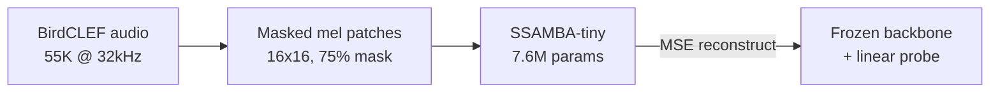
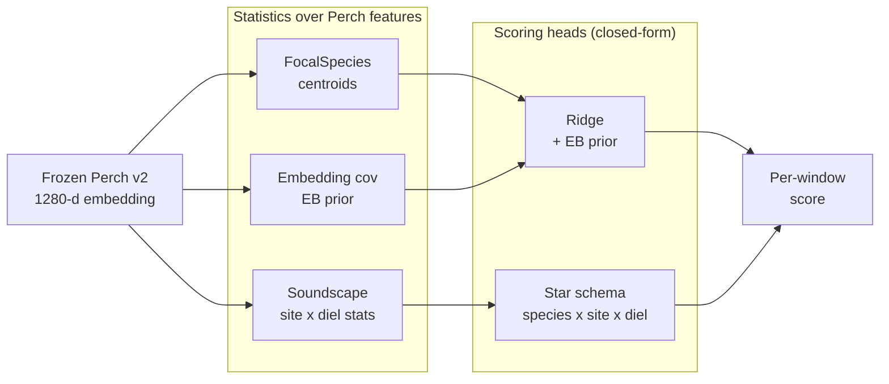
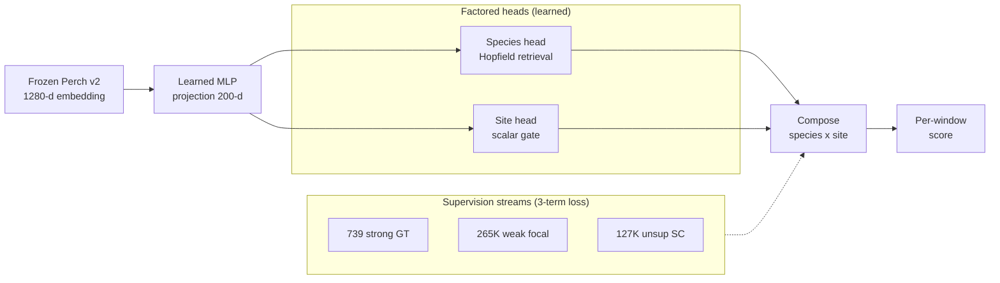
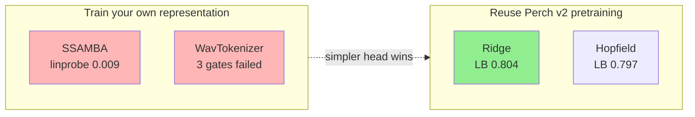

# Four Modeling Approaches — BirdCLEF 2026

**Author**: Anthony
**Date**: 2026-04-27
**Purpose**: Slide-ready summary of four approaches explored. Each diagram is a self-contained Mermaid block intended to be rendered (e.g., via [mermaid.live](https://mermaid.live)) and pasted into Google Slides as an image.

---

## 1. SSAMBA SSL — masked patch pretraining (exp 103)



**Talking points**
- Trained SSAMBA-tiny from scratch on 55K bird clips at 32 kHz; reconstruction did learn (R² 0.29 → 0.45) but linear probe came back at **0.009 cmAP** (random ≈ 0.004).
- Paused as **inconclusive**, not failed — Bird-MAE paper shows linear probe is a known-bad evaluator for MAE features (13 vs 49 mAP gap), and we're 14× below the smallest tested SSL data scale.

---

## 2. WavTokenizer — discrete codec retrieval (exp 104)

```mermaid
flowchart TB
    subgraph Query ["Query path"]
        direction LR
        A[Audio<br/>@ 24kHz] --> B[WavTokenizer<br/>4096-vocab codec]
        B --> C[Token<br/>sequence]
        C --> D[k-mer<br/>super-tokens]
    end
    subgraph Ref ["Reference (per species)"]
        R[k-gram index]
    end
    D --> E[Inverted index<br/>lookup]
    R --> E
    E --> G[Species score<br/>by k-mer overlap]
```

**Talking points**
- Speech-trained codec destroyed bird features: round-trip Perch cosine **0.31** (gate 0.90), top-1 species **9%** (gate 80%), retrieval P@10 **0.20** (gate 0.80, random ≈ 0.10).
- Per-species pattern was the smoking gun — frogs and dogs survived (low-freq, tonal); high-freq passerines were destroyed. Not the framework's fault, the tokenizer's: needs a bioacoustic codec, none exists off-the-shelf.

---

## 3. Perch Bayesian — ridge + star schema (exp 106)



**Talking points**
- **Best result on the project**: ridge on focal Perch embeddings with EB prior reached **LOSO AUROC 0.749 → Kaggle LB 0.804** (new personal best, ~360K params).
- Star-schema cosine got **0.816 on 42 species** that have focal data but failed completely on 28 species without — site priors had zero net effect because domain shift and site structure live in the same logit dimensions.

---

## 4. Hopfield prototypes — learned star schema (exp 107)



**Talking points**
- More sophisticated than ridge — learned 200-d projection, Hopfield species retrieval, 3-stream loss (739 GT + 265K focal + 127K unsupervised SC) — yet **lost on the LB: 0.797 vs ridge 0.804** despite ~10× the parameters.
- Suspected cause: the **scalar site gate under-shares** vs ridge's direct species×site composition. v2 candidate (cross-bank attention between species and site banks) was designed to fix this but didn't get tested before pivoting.

---

## Results comparison

| # | Approach | Representation | Learned | Params | Best LOSO / cmAP | Kaggle LB | Verdict |
|---|----------|---------------|---------|--------|------------------|-----------|---------|
| 1 | SSAMBA SSL              | trained from scratch       | full backbone (MAE) | 7.6M  | linprobe **0.009 cmAP** (random ~0.004) | — | **paused** (eval inconclusive; data 14x below SSL scale) |
| 2 | WavTokenizer retrieval  | speech-trained discrete codec | none (zero-shot) | — | round-trip cos **0.313** (gate 0.90); P@10 **0.195** (gate 0.80) | — | **rejected** (3 gates failed) |
| 3 | Perch Bayesian (ridge)  | Perch v2 frozen            | linear head + EB prior | ~360K | LOSO AUROC **0.749** | **0.804** | **best** |
| 4 | Hopfield prototypes     | Perch v2 frozen + learned MLP | projection + heads + 3-loss | 3.9M  | LOSO AUROC 0.658 - 0.780 (null-anchor) | 0.797 | below ridge by -0.007 |

## Key takeaway



Every win came from **reusing Perch's supervised pretraining** rather than learning the representation ourselves. On top of frozen Perch, the simpler closed-form head beat the more sophisticated neural one — likely because a scalar site gate under-shares vs direct species-by-site composition.
