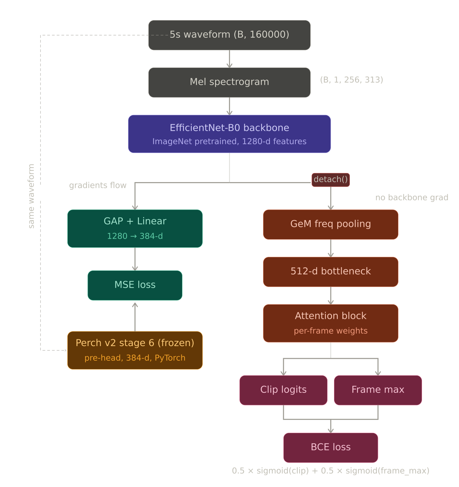

# Kaggle Discussion: Distilled SED Baseline (Tucker Arrants)

- **URL**: https://www.kaggle.com/competitions/birdclef-2026/discussion/ — Tucker Arrants
  "Distilled SED Baseline" (paste the canonical URL here when known)
- **Posted**: 2026-04-24 (15 days ago at 2026-05-09 capture)
- **Captured**: 2026-05-09
- **Author**: Tucker Arrants (rank 920th at capture; previously 918th / 248th in
  earlier pulls of the "best single model" thread)
- **Public notebook**: shared by Tucker; 0.917 LB after 5-tap Gaussian smoothing
- **Companion thread**: cross-references hengck23's earlier post on
  Perch-distilled CNNs (the original idea source)

---

## TL;DR

**This post is the structural confirmation of the KD-on-labeled lever** that the
2026-04-28 PL-vs-KD distinction in
`user/murilo/analysis/notes/2026-04-28-next-experiment-direction.md` flagged as
"never tried." Tucker:

1. Distills **Perch v2's 1536-d embeddings** into the SED backbone via **MSE**
   (not KLD on logits — embedding-space distillation).
2. Trains the SED classification head on **detached / stop-gradient** features
   from the backbone, so the two losses (distillation MSE, classification BCE)
   never fight for the backbone.
3. Throws the distillation head away at inference — only the SED branch ships.
4. Reports a **consistent +0.02 LB** with vs without distillation, on both
   CV and public LB. Same model + 5-tap Gaussian smoothing → **0.917 LB**.

**Critical implementation detail** (separates this from "joint KLD on logits"):
the SED head uses `feat.detach()` from the backbone. Distillation drives
backbone learning; classification uses a frozen-from-its-perspective feature.

This is a *third* category of "Perch as teacher" we hadn't enumerated cleanly:

| Category | What gets distilled | Loss against teacher | Where the gradient goes |
|---|---|---|---|
| #1 PL on unlabeled | per-clip class probabilities | BCE on PL | full backbone (via student loss) |
| #2 KD on labeled (logits) | per-class logits | KLD vs Perch logits + BCE on labels | full backbone, both losses |
| #3 KD on labeled (embeddings) | **1536-d Perch embedding** | **MSE on embedding + BCE on labels with stop-gradient** | **two-headed: dist drives backbone; cls uses detached features** |

Tucker's recipe is **#3**. EliKal's "10 epochs of distillation with KLD loss"
is most likely **#2**. Our exp 014/015/025 ran **#1** — none of them touch
backbone features the way #3 does.

---

## Architecture


Reproducing from the diagram + post:

```
                 ┌─────────────────────────────────┐
                 │   Mel spectrogram (5s, B0 mel)  │
                 └────────────────┬────────────────┘
                                  │
                                  ▼
                       ┌──────────────────────┐
                       │ EfficientNet-B0      │
                       │  (timm, 1280-d head) │
                       └─────────┬────────────┘
                                 │
                ┌────────────────┴────────────────┐
                │                                 │
                ▼                                 ▼
    ┌──────────────────────┐             ┌──────────────────────┐
    │ Distillation head    │             │ feat.detach()        │
    │  (1280 → 1536 proj.) │             │  (stop gradient)     │
    │                      │             │                      │
    │  pred_emb (B,1536,T) │             │     (B,1280,T)       │
    └──────────┬───────────┘             └──────────┬───────────┘
               │                                    │
               ▼                                    ▼
    ┌──────────────────────┐             ┌──────────────────────┐
    │ MSE vs Perch v2 emb  │             │ SED head             │
    │  (teacher, frozen)   │             │  (BirdCLEF-style)    │
    │                      │             │  → 234 classes       │
    │   dist_loss          │             │   cls_loss (BCE)     │
    └──────────────────────┘             └──────────────────────┘
              │                                     │
              └─────────── total = dist + cls ──────┘
              (only dist updates the backbone; cls only updates the SED head)
```

**Key components**:

- **Backbone**: EfficientNet-B0 (timm). 1280-d feature output.
- **Distillation head**: linear projection 1280 → **1536** (Perch v2 embedding
  dim). Trained with **MSE** against the teacher's frozen 1536-d embedding for
  the same input.
- **Teacher**: Perch v2 (frozen). Tucker notes: "trained on 14,795 species" —
  representation source.
- **SED head**: standard BirdCLEF SED head (Tucker calls it "from previous
  BirdCLEF competitions"; he flags it as likely sub-optimal for 5s windows
  and worth replacing).
- **Stop-gradient**: SED head receives `feat.detach()` from backbone. So the
  classification BCE *cannot back-propagate through the backbone*. Only the
  distillation MSE updates the backbone.

**Why the stop-gradient matters** (Tucker's framing): "the two losses never
fight over the backbone." The backbone optimization target is "match Perch" —
the classification head learns to read off the Perch-aligned representation.

### Cheaper-but-equivalent variant (5 days later)

Tucker added a follow-up tweak (image: `tucker-distilled-sed-arch2.png`):

> You can save some training time and add cheap diversity, without impacting
> overall model performance, by distilling from deeper layers of Perch. For
> example, distilling from the 384-d output of Perch's last MBConv stage
> instead of its final 1536-d head, like this:



**Result**: same LB, **20% faster training**. The teacher target dimension
shrinks 1536 → 384, so the projection head is smaller and the MSE is computed
in a lower-d space. Worth using as a default if reproducing.

---

## Training results (from Tucker's logs — fold-1 example, 0.922 LB)

```
Epoch:     1       2       3       4       5       6       7       8       9      10
cls_loss : 0.2533  0.0594  0.0511  0.0458  0.0424  0.0404  0.0386  0.0378  0.0366  0.0361
dist_loss: 0.0122  0.0089  0.0073  0.0062  0.0055  0.0051  0.0048  0.0045  0.0044  0.0042
ns22_auc : 0.617   0.767   0.855   0.904   0.906   0.909   0.926   0.898   0.905   0.897

Epoch:    11      12      13      14      15      16      17      18      19      20
cls_loss : 0.0357  0.0349  0.0344  0.0342  0.0339  0.0334  0.0333  0.0334  0.0331  0.0326
dist_loss: 0.0040  0.0039  0.0038  0.0037  0.0036  0.0036  0.0035  0.0035  0.0034  0.0034
ns22_auc : 0.916   0.917   0.913   0.916   0.913   0.919   0.934   0.929   0.924   0.931

Epoch:    21      22      23      24      25
cls_loss : 0.0326  0.0323  0.0323  0.0325  0.0322
dist_loss: 0.0033  0.0033  0.0033  0.0033  0.0033
ns22_auc : 0.929   0.929   0.928   0.928   0.929
```

Reading the trajectory:

- **`cls_loss`**: ~93% drop in epoch 1 (0.253 → 0.059), then slow grind. Healthy
  decay to end of epoch 25.
- **`dist_loss`**: monotone decay to a **floor of ~0.0033**. Tucker attributes
  the floor to (a) mel-spec parameter mismatch between Perch and student, and
  (b) SpecAugment applied to the student mel but **NOT** to the teacher input
  used to compute the target embedding. Worth investigating.
- **`ns22_macro`** (his domain-shift proxy — macro AUROC on s22, the dominant
  site): rises 0.62 → ~0.93 by epoch 17, then stays flat.

### Tucker's bug-flag (v2 of the public notebook)

> I use best macro for inference not best ns22. Sometimes they are the same
> epoch, but not always.

→ Best-by-`macro_auc` ≠ best-by-`ns22_auc`. He saved the macro-best, but
recommends trying both. Worth flagging as a checkpoint-selection axis if we
replicate.

### Compute footprint

| Setting | Time per epoch (G4 / RTX 6000 Pro Colab, batch_size=64) |
|---|---|
| Without distillation | ~30 s |
| **With distillation** | **~60 s** (Perch teacher inference each batch) |
| Kaggle kernel as-is | ~100 s/epoch (kernel I/O overhead — Tucker calls this "tediously slow") |

**Speed-up Tucker recommends**: precompute Perch embeddings once and load them
in instead of running Perch inference every batch. Removes the ~30 s/epoch
overhead from teacher forward passes. Tucker provides his preprocessing script
for waveforms; Perch-embedding caching can be layered on top.

---

## Tucker's waveform preprocessing script (verbatim)

Tucker's framing: *"That is indeed very very slow, here is the code I used to
preprocess the waveforms. I did this a month or so ago right after joining the
competition, it may be stale - but it is what the model was trained on."*

```python
# ---- CONFIG ------------------------------------------------------------------
SR = 32000                  # target sample rate
AUDIO_DIR  = Path("/path/to/audio")           # where source files live
OUTPUT_DIR = Path("/path/to/waveform_cache")
AUDIO_EXTS = (".flac", ".wav", ".ogg", ".mp3")

# Optional: if you have a metadata CSV listing the files you care about
# (with a "filename" column = bare filename), point to it here. Otherwise
# the script just caches every audio file under AUDIO_DIR.
META_PATH: Path | None = None  # e.g. Path("/path/to/metadata.csv")
# ------------------------------------------------------------------------------

def load_audio_32k(path: Path, target_sr: int = SR) -> np.ndarray:
    """Decode any soundfile-supported format, force mono, resample to target_sr."""
    audio, file_sr = sf.read(str(path), dtype="float32", always_2d=False)
    if audio.ndim == 2:                       # stereo -> mono
        audio = audio.mean(axis=1)
    if file_sr != target_sr:
        g = gcd(int(file_sr), target_sr)
        audio = resample_poly(audio, target_sr // g, int(file_sr) // g).astype(np.float32)
    return audio

def save_int16(waveform_np: np.ndarray, path: Path) -> int:
    """Absmax-normalize, scale to int16, save as a torch tensor. Returns n_samples."""
    waveform = torch.from_numpy(waveform_np).float()
    absmax = waveform.abs().max()
    if absmax > 0:
        waveform = waveform / absmax
    waveform_int16 = (waveform * 32767).clamp(-32767, 32767).short()
    torch.save(waveform_int16, path)
    return len(waveform_int16)

def main():
    OUTPUT_DIR.mkdir(parents=True, exist_ok=True)
    audio_cache_dir = OUTPUT_DIR / "audio"
    audio_cache_dir.mkdir(exist_ok=True)

    # ---- Decide which files to cache --------------------------------------
    if META_PATH is not None:
        meta = pd.read_csv(META_PATH)
        wanted = set(meta["filename"].unique())
        source_files = [p for ext in AUDIO_EXTS for p in AUDIO_DIR.rglob(f"*{ext}")
                        if p.name in wanted]
    else:
        source_files = [p for ext in AUDIO_EXTS for p in AUDIO_DIR.rglob(f"*{ext}")]

    print(f"Found {len(source_files):,} audio files to cache")

    # ---- Cache loop (resumable) ------------------------------------------
    existing = {f.name for f in audio_cache_dir.glob("*.pt")}
    records, errors = [], 0
    t0 = time.time()

    for idx, src in enumerate(tqdm(source_files, desc="Caching")):
        cache_name = f"{idx:06d}.pt"
        cache_path = audio_cache_dir / cache_name

        if cache_name in existing:
            n_samples = len(torch.load(cache_path, map_location="cpu"))
        else:
            try:
                audio = load_audio_32k(src)
                n_samples = save_int16(audio, cache_path)
            except Exception as e:
                errors += 1
                if errors <= 5:
                    print(f"  Error on {src.name}: {e}")
                continue

        records.append({
            "original_filename": src.name,
            "cache_file": f"audio/{cache_name}",
            "n_samples": n_samples,
            "duration_sec": round(n_samples / SR, 2),
        })

    # ---- Write the index --------------------------------------------------
    pd.DataFrame(records).to_csv(OUTPUT_DIR / "cache_index.csv", index=False)

    total_hours = sum(r["duration_sec"] for r in records) / 3600
    print(f"\nDone in {time.time() - t0:.0f}s")
    print(f"  Cached: {len(records):,} files ({total_hours:.1f} h)")
    print(f"  Errors: {errors}")
    print(f"  Index:  {OUTPUT_DIR / 'cache_index.csv'}")

if __name__ == "__main__":
    main()
```

### Notes for porting to our pipeline

- **int16 absmax-normalize** is intentional: stores as ~half the float32 size,
  recovers full precision at load via `tensor.float() / 32767.` Per-file
  amplitude normalization is baked into the cache (so loudness varies between
  files but each file is consistent at load time).
- **gcd-based polyphase resampling** via `scipy.signal.resample_poly` — clean,
  no anti-alias artifacts. Matches what we already use in `dataset.py`.
- **Sequential `idx`-based filenames** (`000000.pt`, `000001.pt`, ...) instead
  of preserving original filenames. Resolved via `cache_index.csv`. Avoids
  filename-collision issues across mixed source dirs and is faster to
  enumerate at training time. Different from our current per-recording-id
  cache layout — would need adapter logic if we adopted this directly.
- **Resumable** via `existing = {f.name for f in audio_cache_dir.glob("*.pt")}`
  + skip-if-exists. Uses pre-existing on-disk cache as the source of truth.
  Safe to re-run.
- **Optional metadata-CSV gating** (`META_PATH`) lets the script cache only
  the files referenced in `train.csv` (and skip stray audio in the source
  dir). We'd point this at our 2026 train.csv if porting.
- **Dependencies** (not imported at top of Tucker's snippet): `soundfile as sf`,
  `numpy as np`, `pandas as pd`, `torch`, `tqdm.auto.tqdm`, `pathlib.Path`,
  `math.gcd`, `scipy.signal.resample_poly`, `time`.
- We already cache 32 kHz audio in our pipeline, so this is mostly redundant
  for us. Worth borrowing if we need a smaller cache footprint (int16 is
  half the size of our current float32 cache).

---

## Comments thread (key exchanges)

### Jack (17th) — Posted 7 days ago ⭐ (BUG-PROBE + 0.901 BASELINE)

> If you tried it, what's your score without distillation? Also, did any of
> your folds lead to no positive predictions on local soundscapes? I believe
> you changed the pipeline a bit from your notebook but just curious

### Tucker Arrants (920th) — Posted 7 days ago ⭐ (CONFIRMS +0.02)

> Without distillation is consistently 0.02 worse than with distillation.
> This is true of public leaderboard and CV. This was also reported by Hengk
> in his original discussion post.
>
> The only difference between how it was trained locally and the Kaggle
> notebook is the fold split, which I have hard coded locally but it is still
> fundamentally just a split on filenames for soundscapes and a stratified
> split on focal labels.
>
> [...]
>
> The other difference has been noted as a bug on v2 of the notebook: I use
> best macro for inference not best ns22. Sometimes they are the same epoch,
> but not always.
>
> As for no positive predictions, no, they are all positive.

### Jack (17th) — Posted 7 days ago

> Oh, I guess I should try distillation then. I got 0.901 with no TTA or post
> processing and have a better model I haven't tested. I had some interesting
> rows using code inspired by yours so was planning on improving folds to help
> alleviate that… just unsure if that's normal

### MengYe (71st) — Posted 11 days ago ⭐ (SMOOTHING TRICK = +0.004)

> i applied my smoothing function to v1 predictions (no code changes), and got
> 0.921 lb

### Tucker Arrants — Posted 11 days ago

> That is a substantial boost, do you mind sharing how your smoothing differs
> from the 5 tap Gaussian kernel I applied, or is that a secret?

### MengYe — Posted 11 days ago

> different weights on adjacent categories, like doing a fourier transformation

### Salman Ahmed — Posted 10 days ago

> What do you mean by adjacent categories @konohayui

### MengYe — Posted 10 days ago

> i mean adjacent labels

(MengYe's smoothing is across the **label dimension**, not the time dimension.
Cross-class label smoothing applied at inference. Worth investigating — our
current pp2 smooths in time, not across species.)

### MarkDjadchenko (374th) — Posted 12 days ago (REPRODUCING)

> Hi, great notebook, could you share the training logs? I just want to check
> that everything is ok because ns22 isn't growing much and stops at 10 epochs,
> and I wonder if 25 epochs makes sense. I trained with 2 folds + 10 epochs
> and got 0.878 LB.

### Tucker Arrants — Posted 12 days ago

> CV is tricky for this competition so I track many metrics but my main
> diagnostic is the loss. The distillation and classification loss have
> healthy decays through the end of epoch 25. My ns22 metric is to see if the
> model is overfitting to s22, which is the dominant site.

[Full training logs included above.]

> The floor on the distillation loss is primarily due to the difference in
> mel spec parameters between Perch and the student model, as well as the
> SpecAugment applied to the students mel but not the teacher (this is
> something worth exploring for yourself...)
>
> Try a quick test between submitting with the ns22 auc save and the macro
> auc save - you might see a big difference between the two.

### yukiya (28th) — Posted 14 days ago (DISTILL VS PROTOSSM)

> Thank you for sharing! Do you think this is more promising than the current
> ProtoSSM trend in the public notebook?

### Tucker Arrants — Posted 14 days ago

> They both have their strengths and weaknesses. The distilled CNN approach
> is a middle ground — you get to use all the regular image classification
> tricks and draw on years of BirdCLEF solutions, while still exploiting
> Perch's representational strength as a teacher rather than trying to build
> something from scratch.

### Kurise (26th) — Posted 14 days ago (SLOW TRAINING)

> Hi @tuckerarrants Thanks for sharing! Could you please offer your code
> about data processing to .pt? I try to reuse your code in competition data,
> but it's very very slow(about 1500s one epoch in rtx3090). Seems like .pt
> data can have a large speed up.

### Tucker Arrants — Posted 14 days ago

> That is indeed very very slow, here is the code I used to preprocess the
> waveforms. [...code shared above...]

### Baidalin Adilzhan (287th) — Posted 9 days ago

> Hi! Amazing work. Could you share what gpu did you use to train and runtime
> for specific epoch and fold settings using that gpu?

### Tucker Arrants — Posted 9 days ago

> The G4 on Colab (RTX 6000 Pro). It takes about 30s an epoch with 64 batch
> size without distillation, and about 60s an epoch with Perch distillation.
> I try to be selective with my runs because the cost adds up.

---

## What this confirms / changes for us

### Confirms

1. **Perch KD is the +0.02 lever** that the kaggle-discussion synthesis already
   suspected. Tucker's own data ("0.02 less without distillation, true on CV
   and LB") + his Kaggle notebook at 0.917 LB + Jack's 0.901 baseline (will
   try distillation next) + EliKal's 0.909 with KLD-distillation = three
   independent data points around the same effect size.
2. **The KD-on-labeled lever is structurally distinct from PL-on-unlabeled**.
   Our exp 014/015/025 "dead" verdict was about #1 (PL on unlabeled). Tucker's
   recipe is #3 (embedding KD on labeled, two-headed with stop-gradient). They
   are not the same experiment.
3. **Hengck23's earlier post is the original idea source.** Tucker is just
   implementing what Hengk described. Worth pulling Hengck23's post and
   capturing it as a separate reference doc.
4. **The Tucker recipe is reproducible from the public notebook.** A faithful
   replication doesn't require us to invent the architecture; it just requires
   us to (a) wire Perch v2 embeddings into our training loop and (b) flip the
   gradient flow to two-headed with detach.

### Refines our prior questions

- **"Why did Tucker succeed where exp 015/025 failed?"** Now answered: he's
  doing a structurally different thing (#3 embedding KD on labeled vs #1 PL on
  unlabeled). Not a recipe-detail difference; a different experiment entirely.
- **"What does EliKal's 10ep KLD distillation look like?"** Probably #2
  (logit-space KLD on labeled). Tucker's #3 (embedding-space MSE) is a
  variant. Both are KD-on-labeled, both engage the 04-25 mechanism.
- **"What teacher dimension to target?"** 1536-d (Perch's final embedding) and
  384-d (Perch's last MBConv stage) both yield the same LB; the deeper-layer
  variant is 20% faster. This is a low-risk implementation choice.

### Open questions for replication

1. **Mel-spec mismatch contributes to the dist_loss floor.** Tucker uses
   B0-style mel; Perch v2 uses its own mel (likely different n_fft / hop /
   n_mels). To reduce the floor: align the student's mel to Perch's, or apply
   SpecAugment to both branches, or skip SpecAugment on the dist branch only.
   Worth a short ablation.
2. **Can we use our 0.929 Perch+SED ensemble as the teacher** instead of Perch
   v2 alone? Stronger teacher → potentially better student. But MSE-on-embedding
   only makes sense if the teacher *has* a 1536-d embedding; our ensemble
   doesn't expose one. So Perch v2 is the natural choice for embedding-space KD.
3. **SED head choice.** Tucker says his is "from previous BirdCLEF competitions"
   and "likely optimized for durations longer than 5s." We have v5j's LSEHead
   already wired up; using it as the SED branch might be a tighter
   single-variable change vs Tucker's recipe.
4. **Best-by-which-metric.** Tucker reports a real LB difference between
   best-by-`ns22_auc` and best-by-`macro_auc`. We log both already; saving
   `save_top_k=-1` would let us pick post-hoc.
5. **MengYe's cross-label smoothing** (+0.004 LB on top of Tucker's notebook).
   Different from our pp2 (which smooths in time). Worth implementing as a
   separate inference-side experiment after the KD run.

---

## Implementation sketch (when ready)

This is not the experiment proposal yet — that should come after the
Phase-1 PL-vs-KD post-mortem in
`user/murilo/analysis/notes/2026-04-28-next-experiment-direction.md`. Captured
here so the post-mortem has a concrete reference to compare against.

```python
# Pseudocode for the Tucker recipe in our codebase
# (sed_finetune.py would need a new branch)

def forward(self, x, labels):
    # x: waveform (B, T)
    mel = self.mel_transform(x)              # (B, 1, F, T')
    feat = self.backbone(mel)                # (B, 1280, T')

    # Distillation branch — gradient flows to backbone
    pred_emb = self.dist_proj(feat)          # (B, 1536, T') or (B, 384, T') for the cheap variant
    with torch.no_grad():
        teacher_emb = self.perch(x)          # (B, 1536, T') frozen
    dist_loss = F.mse_loss(pred_emb, teacher_emb)

    # Classification branch — gradient does NOT flow to backbone
    feat_detached = feat.detach()
    sed_out = self.sed_head(feat_detached)   # (B, 234)
    cls_loss = F.binary_cross_entropy_with_logits(sed_out, labels)

    total = dist_loss + cls_loss
    return total, sed_out
```

Open implementation choices for our codebase:

- Which Perch v2 checkpoint to use (and where it lives — vendor under
  `vendor/kaggle/perch_v2/`?).
- Whether to precompute Perch embeddings once and stream from disk (Tucker
  recommends; saves the 30 s/epoch teacher forward overhead).
- Whether to use the 1536-d final embedding or the 384-d last-MBConv-stage
  variant. Default to 384-d for the faster training.
- Whether to keep our LSEHead as the SED head, or port Tucker's SED head as-is.
  LSEHead is the smaller delta from v5j and easier to compare.
- MixUp interaction: should mixup happen *before* or *after* the Perch teacher
  forward? Mixed waveform → mixed teacher target is the natural choice
  (consistent supervision); pre-mix teacher target on the un-mixed audio would
  break the alignment. Tucker doesn't say.

---

## Files

- This note: `user/murilo/notes/kaggle-discussion-tucker-distilled-sed-baseline.md`
- Architecture diagram (1536-d, default): `user/murilo/notes/figures/tucker-distilled-sed-arch.png`
- Cheap-variant diagram (384-d MBConv stage): `user/murilo/notes/figures/tucker-distilled-sed-arch2.png`
- Cross-references:
  - `user/murilo/notes/kaggle-discussion-best-single-model-lb.md` (Tucker's
    score history + KD lift quantification table)
  - `user/murilo/analysis/notes/2026-04-28-next-experiment-direction.md` ADDENDUM
    (the PL vs KD distinction this post structurally confirms)
  - `docs/references/kaggle/birdclef-2025/birdclef2025-2nd-place-domain-shift.md`
    (Sydorskyi's "soft pseudo-distillation" — different mechanism, also a KD
    family approach)
